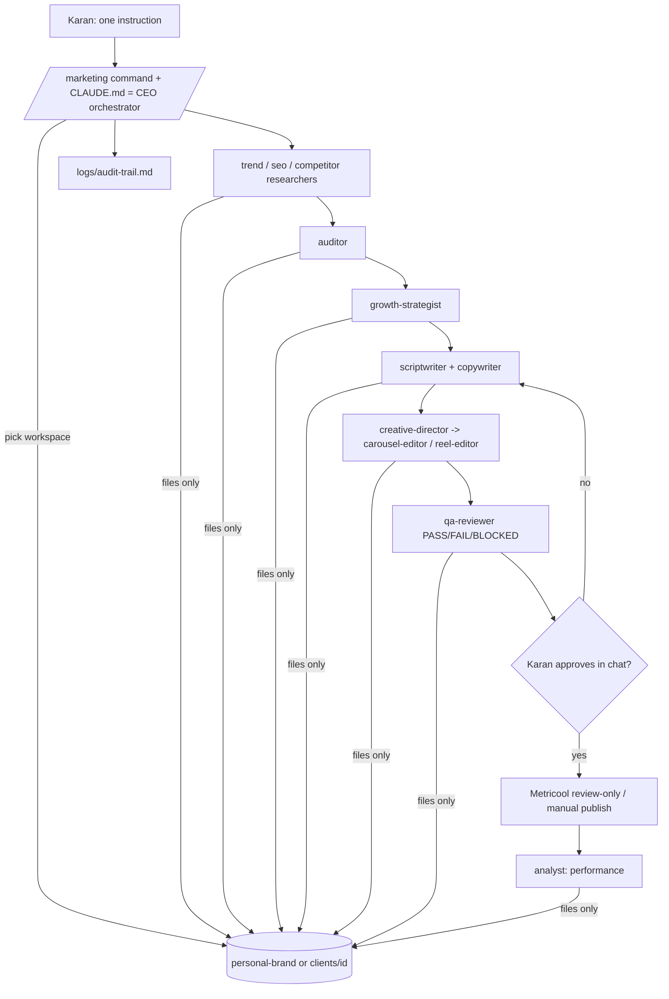

# Architecture

Subagents cannot spawn subagents, so the orchestrator (main session) chains specialists through files.
Isolation: one workspace per task; shared config (.claude/) contains no client names (tests/isolation.py).
