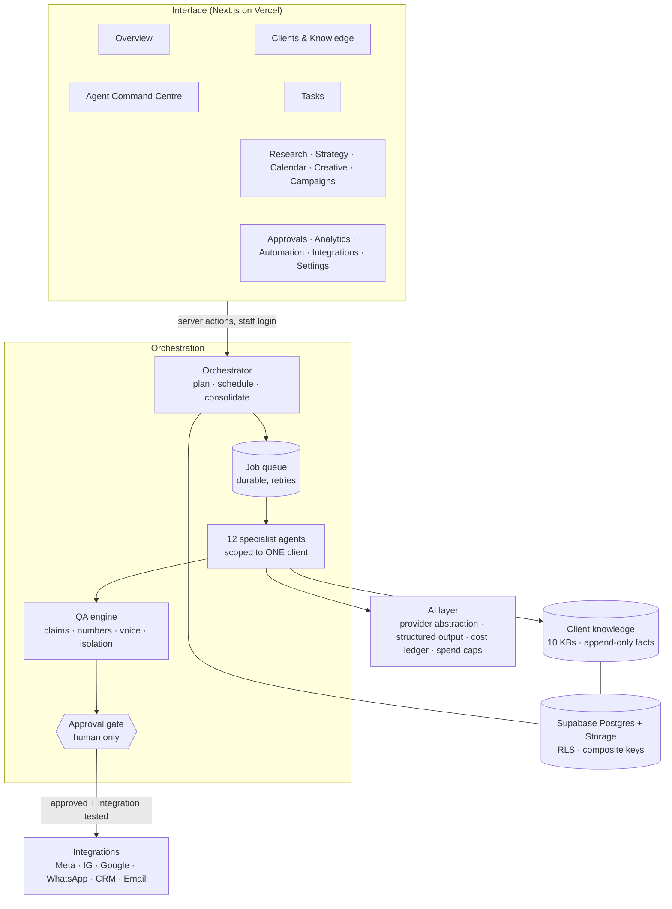
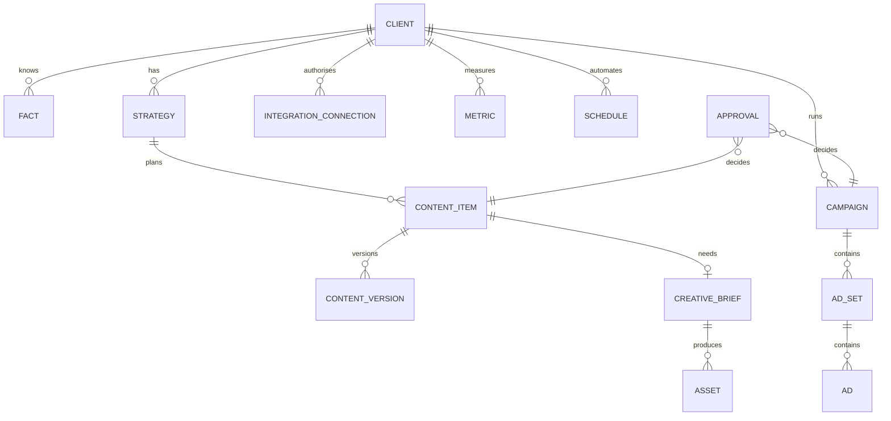
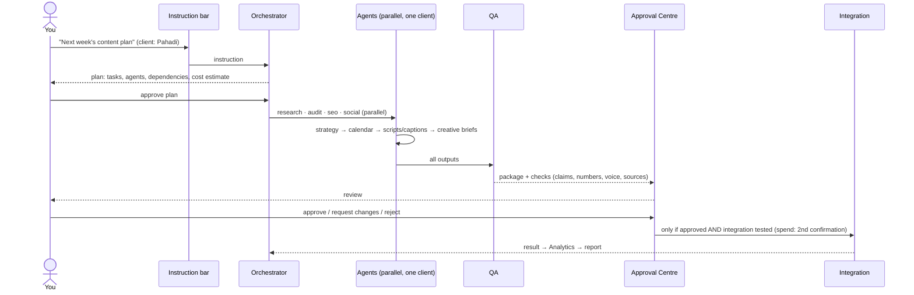

# Marketing OS — Product Blueprint (Deliverable 1)

> **Design document + clickable prototype. The prototype is NOT a connected feature.** All prototype data is sample (labelled). The "Today in the app" column states what actually exists in `/hq` right now.
> Prototype: `docs/prototype/index.html` (open in any browser, no server needed). Screenshots: `docs/blueprint/`.
> Status of this document: **awaiting your review** (nothing from Deliverables 2–6 has been started).

## A. Application architecture


**Principles:** one client per task (isolation by construction) · agents draft, humans decide · every fact has a source and a certainty label · every external write passes the Approval Gate · AI spend is capped and logged · nothing is claimed "working" until tested.

## B. Navigation and screen hierarchy
```
Marketing OS
├─ [Client switcher]  [Instruction bar → Orchestrator]      (global, every screen)
├─ AGENCY    1 Agency Overview · 2 Client Management · 3 Client Knowledge Centre
├─ AGENTS    4 AI Agent Command Centre · 5 Task Management
├─ WORK      6 Research & Audit · 7 Marketing Strategy · 8 Content Calendar · 9 Creative Studio · 10 Campaign Manager
└─ CONTROL   11 Approval Centre · 12 Analytics & Reports · 13 Automation Centre · 14 Integrations · 15 Settings & Permissions
```
How modules connect: Knowledge → (Research & Audit) → Strategy → (Content Calendar ⇄ Creative Studio) → Campaign Manager → **Approval Centre** → Integrations (execution) → Analytics → back into Knowledge and Strategy. Automation Centre re-runs chains on a schedule and always stops at the Approval Centre.

## C. Dashboard wireframe (screen 1)
```
┌ [Client ▾] [ Give the Orchestrator one instruction…            ] [Send] ┐
│ Clients 3 │ Agents 12 (0 real model) │ Pending approvals 3 │ Real AI ₹0 │
├──────────────────────────────────────────┬───────────────────────────────┤
│ NEEDS YOUR ATTENTION                     │ ACTIVE RUN (live timeline)    │
│  [Content] Week plan …          [Review] │  research        ███▒▒▒       │
│  [Ad launch] blocked: no budget [Review] │  audit_strategy  ██▒▒▒▒       │
│  [Conflict] Propedia colours  [Resolve]  │  content / creative / seo …   │
│  [Missing] Pahadi: budget, goal [Provide]│  → consolidate → QA → deliver │
├──────────────────────────────────────────┴───────────────────────────────┤
│ CLIENTS  [Pahadi ▓▓▓▓░░ 5/10 KBs · 7 gaps] [Propedia …] [Personal …]      │
└──────────────────────────────────────────────────────────────────────────┘
```
## D. Client workspace wireframe (screens 2–3)
```
Client Knowledge Centre — Propedia                      [Draft questionnaire]
 ⚠ Conflict: brand colours navy+red  vs  green+gold   [Resolve…]
 [All|business|brand|audience|competitor|content|strategy|campaigns|performance|assets|requirements]
 ┌ KB ┬ key ┬ value ┬ STATUS ┬ source ┐      ┌ Information we still need ─┐
 │ …  │ …   │ …     │ badge  │ chip   │      │ ☐ JKRERA status  ☐ budget │
 └────┴─────┴───────┴────────┴────────┘      │ Add/update fact (source!)  │
 Facts are append-only; updates make a new version.   │ Import checklist          │
```
## E. Agent control centre wireframe (screens 4–5)
```
Legend: [Rules only] [Rules + Mock AI tested] [Real AI — none yet]
┌ 12 agent cards (click) ───────────────────────┐ ┌ Content Strategist ─────────┐
│ Research  [Rules+Mock]  idle · reads 4 KBs    │ │ identity · responsibilities │
│ Audit/Strategy …  Social …  Content …         │ │ needs: content.pillars …    │
│ Creative … Video [Rules only] … Paid Ads …    │ │ reads KBs · tools · outputs │
└───────────────────────────────────────────────┘ │ evidence: tests run         │
Task board: PENDING | IN PROGRESS | WAITING FOR INPUT | WAITING FOR APPROVAL | UNDER REVIEW | COMPLETED | FAILED
Run graph: 7 agents ─► consolidate ─► QA ─► deliver
```
## F. Content and creative studio wireframes (screens 8–9)
```
Calendar (week/month)                         │ Post detail
 Mon  Tue  Wed  Thu  Fri  Sat  Sun            │ Reel — hook…             [Draft]
 [Reel][ ] [Carousel!] [ ] [Static][Reel]     │ Caption ……………………………
 colour = state: draft / changes / approved   │ Script 0–3s HOOK … 
                                              │ QA ✅ voice ✅ price ❌ scarcity claim
                                              │ [Approve (disabled while ❌)] [Request changes]
Creative Studio: brief ▸ [storyboard frame] concept · image prompt · video prompt
                 brand check (palette confirmed? ❌ blocks generation) · asset slots · [Generate…(approval + credits)]
```
## G. Campaign management wireframe (screen 10)
```
Campaign ▸ Ad sets ▸ Ads (tree)           │ Launch checklist
 ad copy variants + claim check           │ ☐ budget ₹ ☐ goal ☐ landing page ☐ claims verified
 audience (AI suggestion, unvalidated)    │ ☐ tracking ☐ Meta connected+tested ☐ YOUR approval
 budget split (needs your budget)         │ [Submit for launch approval] (disabled until all ticked)
```
## H. Approval centre wireframe (screen 11)
```
Inbox: [Content] [Ad launch] [Client message] [AI spend limit]        state: pending/blocked/approved
Item ▸ what it is · QA/claim checks · cost impact · client (isolated)
       [Approve] [Request changes] [Reject]  → "Approved. Execution: none unless an integration is connected AND tested."
Audit trail: requested · QA attached · decided by (human) · executed (if ever)
```
## I. Analytics and reporting wireframe (screen 12)
```
KPIs: Reach · Engagement rate · Leads · Cost/lead · ROAS   (real numbers only)
No data?  →  "NO DATA — nothing estimated" [Import CSV] [Connect account]
Charts (trend, by campaign, by post) · period compare · Monthly report [Generate] → Approval Centre before sending
```

## Screen-by-screen specification
| # | Screen | Purpose | Key components | Agents | Connects to | Today |
|---|---|---|---|---|---|---|
| 1 | Agency Overview | Start-of-day cockpit | KPIs, needs-attention list, active run timeline, client readiness | Orchestrator, all | Approvals, Tasks, Knowledge | Partial |
| 2 | Client Management | Create/oversee workspaces | client table, readiness, add-client wizard (4 steps) | Client Service, Audit/Strategy | Knowledge, Agents | Partial |
| 3 | Client Knowledge Centre | Source of truth per client | 10 KBs, status labels, versions, conflicts, gaps, import checklist | all readers | all work screens | Partial |
| 4 | AI Agent Command Centre | Control the 12 agents | capability levels, needs, permissions, evidence, history, cost | all | Tasks, Settings, Integrations | Partial |
| 5 | Task Management | Track every unit of work | board by status, run graph, filters, outputs, retries | Orchestrator | Agents, Approvals | Partial |
| 6 | Research & Audit | Readable sourced reports | findings with source chips, risks, conflicts, gaps, QA verdict | Research, Audit/Strategy, SEO, Social, Analytics | Strategy, Knowledge | Partial |
| 7 | Marketing Strategy | Plan you own | positioning, goals, pillars, 30/60/90, approve/revise versions | Audit/Strategy, Content | Calendar, Campaigns | Not built |
| 8 | Content Calendar | Plan, write, check, approve posts | month/week grid, post detail, QA checks, state machine | Content, Video, Creative, QA | Creative, Approvals, scheduling | Not built |
| 9 | Creative Studio | Briefs → prompts → assets | briefs, layouts, image/video prompts, brand check, asset slots | Creative, Video, QA | Calendar, Integrations | Not built |
| 10 | Campaign Manager | Prepare ads safely | campaign tree, copy variants + claim check, budget, launch checklist | Advertising, Lead/CRM, QA | Approvals, Meta/Google | Not built |
| 11 | Approval Centre | The only door out | inbox, previews, checks, decisions, audit trail | QA, requesting agent | every write | Partial |
| 12 | Analytics & Reports | Honest performance | KPIs, trends, NO-DATA state, monthly report | Analytics, Client Service | Integrations, Campaigns | Not built |
| 13 | Automation Centre | Recurring work | schedules, last/next run, cost, guard-rails, pause-all | Orchestrator | Tasks, Approvals | Not built |
| 14 | Integrations | Connect platforms | status, scopes, read/write, test checklist, per-client credentials | tool-using agents | Approvals, Analytics | Partial |
| 15 | Settings & Permissions | Roles, permissions, limits | role matrix, agent×KB matrix, AI mode/models/caps, backup/security | — | all | Not built |
| + | User journey / Architecture | Blueprint views | stepper; layered diagram | — | — | design |

## J. Database and integration architecture
**Exists (applied on Supabase `marketing-os`):** `agency.{agencies, profiles, clients, client_users, audit_logs}`, `hq.{clients, facts, tasks, approvals, outputs, activity_log, usage}` with RLS. **Written, not applied (needs your approval):** `hq.executions`.
**Needed for the screens (not built):**

All new tables carry `(agency_id, client_id)` composite keys + RLS exactly like `hq.*`. Files/creative assets → Supabase Storage private buckets, path `<agency>/<client>/…`, policies mirroring RLS.
**Integrations model:** one `integration_connection` row per (client, platform): scopes granted, encrypted refresh token (server-side only, never in git/logs), `read_only` flag, `last_tested_at`, `test_result`. An integration is "operational" only after a recorded passing live test. All writes go through `performExternalAction` (approval + tested integration + same client + single use). Order: read-only Instagram insights (Windsor/Meta) → Meta Ads reporting → GA4/GSC → Drive/Sheets → scheduling → ad launch (last, second confirmation for spend).

## K. User journey: instruction → executed work

| Step | Human gate | Built today |
|---|---|---|
| 1 Instruction | — | buttons for fixed workflows only |
| 2 Plan proposal & approval | ✅ you approve plan | not built |
| 3 Research/audit (parallel) | — | built (rules + mock AI) |
| 4 Strategy | — | not built |
| 5 Calendar, scripts, captions | — | not built |
| 6 Creative briefs/prompts | — | not built |
| 7 QA | — | built (rules) |
| 8 Approval | ✅ approve/reject | partial (records only) |
| 9 Execution preparation | — | not built |
| 10 Execution | ✅ approval + tested integration (+spend confirmation) | not built |
| 11 Monitor/report | ✅ report send approval | not built |

## Outstanding development requirements (ordered)
1. **Review & decisions on this blueprint** (below).
2. **Deliverable 2 — real interface**: shell + nav + client switcher; screens 1–5 on existing data first, then 6–15 as data models arrive. Each screen shipped only with tests and a status chip.
3. **Data models** for strategy, content items (+versions, state machine), creative briefs, campaigns, assets, schedules, integration connections, metrics (+RLS tests).
4. **Agent capability work**: Strategy, Content, Video, Creative generators with structured outputs and brand guard; Pahadi demonstration (Deliverable 4).
5. **Real AI activation** (Deliverable 5): key + approval; one agent/one client/₹100 cap.
6. **Infrastructure** (Deliverable 6): repo private, owner login, `DATABASE_URL`, import, apply `hq_executions`, Storage, CI run, durable queue, Vercel, backups.

### Decisions I need from you
1. Agent roster: keep today's 12 (Audit+Strategy merged, Social, Video, no Automation agent) **or** your list (split Audit/Strategy, add Automation, fold Social/Video)? *Recommendation: keep today's 12 for now; Automation is a platform feature, not an agent.*
2. Free-text instructions: OK to start with an Orchestrator that maps your sentence to one of the fixed workflows (with plan preview), and add real AI planning later?
3. Language: UI in English, agent outputs Hinglish where the client brand says so — confirm.
4. Mobile: should the first real build be mobile-first (phone approvals) or desktop-first? *Recommendation: desktop-first, with Approval Centre mobile-friendly from day one.*
5. Any screen you want added, removed or reordered.
